# dnshelper user guide

This guide is for the person who administers an NS8 node. It explains what dnshelper does, how to
give it access to your DNS host, how to decide which modules may change which records, and how to
check that everything works, and how to manage your zones' records yourself. Developers who want to call dnshelper from their own module should
read the [main README](../README.md) instead.

- [What dnshelper does](#what-dnshelper-does)
- [Before you start](#before-you-start)
- [Adding a zone](#adding-a-zone)
- [Managing zones and credentials](#managing-zones-and-credentials)
- [Letting modules change DNS records](#letting-modules-change-dns-records)
- [Working with records](#working-with-records)
- [Settings](#settings)
- [Seeing what happened: the audit log](#seeing-what-happened-the-audit-log)
- [Backup and restore](#backup-and-restore)
- [When something goes wrong](#when-something-goes-wrong)

## What dnshelper does

Some NS8 modules need to change DNS records: a mail server publishing its DKIM key and SPF record,
a certificate client proving that you own a name, a web application publishing its own host name.
Instead of every module asking you for DNS credentials, they ask dnshelper.

dnshelper keeps the credentials for your DNS host, and it keeps a list of rules that say which
module may change which records. A module can only do what a rule allows. Nothing happens to your
DNS until you have done two things:

1. **Add a zone** (a domain, such as `example.com`) and the credential dnshelper uses for it.
2. **Add an access rule** for each module that should be allowed to change records in it.

You, as an administrator, are never limited by the rules: the pages of dnshelper always act with
full access to the zones you added.

The pages of the application, in the side menu:

| Page | What it is for |
|---|---|
| **Status** | How many zones and rules there are, and a shortcut to the audit log |
| **Zones** | The zones dnshelper manages, and the credentials they use |
| **Records** | See and change the records of a zone: edit them, change many at once, import and export zone files, undo changes |
| **Access** | The rules that decide what each module may change |
| **Settings** | How many snapshots of each zone are kept, and for how long |
| **About** | Version and links |

## Before you start

You need **an API credential from your DNS host**. It is not your account password. It is a token
(or a key, or a user name and password made for the purpose) that you create in your DNS host's
control panel and that only allows what dnshelper needs.

Make the credential as narrow as your DNS host lets you: limited to the zones you want dnshelper to
manage, and allowed to edit DNS records. If it is ever leaked, that limits the damage, and you can
revoke it at your DNS host without touching anything else.

| DNS host | What dnshelper asks for | Where to create it |
|---|---|---|
| Cloudflare | An API token that can edit DNS for your zones (the "Edit zone DNS" permission). If the token is limited to one zone, a second token that can read zones is also asked for, so that the zone list works | [Create an API token](https://developers.cloudflare.com/fundamentals/api/get-started/create-token/) |
| ClouDNS | The ID of an **API user**, or better the ID or name of an **API sub-user** given only the zones dnshelper should manage, and its password. Fill in only one of the three ID fields. If you set an allowed IP address for it, use your NethServer's public address | [ClouDNS API](https://www.cloudns.net/wiki/article/42/) |
| Core-Networks ([core-networks.de](https://www.core-networks.de/)) | The login and password of an **API account**. This is not the login you use in the web interface: make a separate API account in the web interface, under API user accounts | [Core-Networks API documentation](https://beta.api.core-networks.de/doc/) |
| deSEC | An API token, made under **Token Management**. It needs neither **Can create domains** nor **Can delete domains**. In the advanced settings, leave **Maximum unused period** empty: dnshelper only uses the token when a record changes, so the token could expire in between. If you limit the token to a subnet, include your NethServer's public address | [Manage tokens](https://desec.readthedocs.io/en/latest/auth/tokens.html) |
| DigitalOcean | A personal access token with **custom scopes**: tick `domain` with create, read, update and delete, and nothing else. DigitalOcean cannot limit a token to some domains: it can change every domain in the account (or team) | [Personal access tokens](https://docs.digitalocean.com/reference/api/create-personal-access-token/) |
| Gandi LiveDNS | A personal access token, made in the Gandi Admin application for the organization that holds your domains, with the permission **Manage domain name technical configurations** (Gandi then also ticks **See and renew domain names**). You can limit it to some domains. Gandi tokens expire: renew or replace yours before its end date, then update the credential here | [Authentication](https://api.gandi.net/docs/authentication/) |
| GoDaddy | A personal access token that can read your domains and manage their DNS records. The older "classic" API key and secret still work, but GoDaddy is retiring them | [GoDaddy developer site](https://developer.godaddy.com/en/docs/api-users/auth) |
| Google Cloud DNS | The JSON key of a service account that has the **DNS Administrator** role in the project holding your zones: paste the whole key file. Give the project ID only if it is not the service account's own project | [Create service account keys](https://cloud.google.com/iam/docs/keys-create-delete) |
| Hetzner | A Hetzner Cloud API token with **Read & Write** permission, made in the project that holds your DNS zones | [Generating an API token](https://docs.hetzner.com/cloud/api/getting-started/generating-api-token/) |
| IONOS | An API key from developer.hosting.ionos.com/keys: its **prefix** and its **secret**, in the two fields. The key reaches every domain in your IONOS account. A domain registered elsewhere can use IONOS's DNS through the DNS Standard package | [IONOS DNS API](https://developer.hosting.ionos.com/docs/getstarted) |
| Linode (Akamai) | A personal access token with **Domains** set to Read/Write and every other scope to No Access. The token reaches every domain of the account, unless you make it as a restricted user granted only some domains | [Manage personal access tokens](https://techdocs.akamai.com/cloud-computing/docs/manage-personal-access-tokens) |
| name.com | Your user name and an API token. Use a **production** token: a development token does not work | [Get your API token](https://docs.name.com/getting-started) |
| OVHcloud | Preferably the client ID (it starts with `EU.`, `CA.` or `US.`) and secret of a **service account**, with an IAM policy that lets it read and change the records of your zones and refresh them. The older application key, application secret and consumer key also work. Choose the endpoint of your region: `ovh-eu`, `ovh-ca` or `ovh-us`. Fill in one login or the other, not both | [OVHcloud API with OAuth2 service accounts](https://help.ovhcloud.com/csm/en-manage-service-account?id=kb_article_view&sysparm_article=KB0059343) |
| Porkbun | The API key and secret API key. Porkbun only lets the key reach domains with **API access** switched on: switch it on for all domains at once, or in the settings of each domain dnshelper should manage | [Porkbun API access](https://kb.porkbun.com/article/190-getting-started-with-the-porkbun-api) |
| Amazon Route 53 | The access key ID and secret access key of an IAM user that may only read and change the records of your hosted zones, and list hosted zones. The README has the exact policy | [IAM access keys](https://docs.aws.amazon.com/IAM/latest/UserGuide/id_credentials_access-keys.html) |
| Vultr | The API key of a **service user** in your organization that has only the **Manage DNS** policy (Vultr asks for an e-mail address no other Vultr account uses). Your account's own key also works, but it can change everything in the account. In the key's API access control, add your NethServer's public address | [Vultr API](https://www.vultr.com/api/) |
| PowerDNS (HTTP API) | The URL of your PowerDNS Authoritative server's API (for example `https://ns1.example.com:8081`), its API key, and the server id, usually `localhost`. The API must be switched on and must accept connections from your NethServer | [PowerDNS HTTP API](https://doc.powerdns.com/authoritative/http-api/index.html) |
| RFC 2136 (BIND, Knot, Technitium, PowerDNS...) | The server address and port, the name of a TSIG key, its algorithm and the key. The server must allow dynamic updates and zone transfers (AXFR) for that key. On Technitium DNS Server, allow both in the zone's options: zone transfer for the key, and dynamic updates with a security policy for the key on the zone and on every name under it | Your DNS server's configuration |

If your account uses two-step authentication, your DNS host may need API access switched on before
tokens work; its documentation says how.

## Adding a zone

Open **Zones** and choose **Add zone**. A four-step wizard asks for everything, and nothing is
saved until the last step.

**1. Choose the DNS host.** Pick where the zone is hosted. The wizard lists what dnshelper can do
with that host. If you already saved a credential for it, you can choose that one and skip the
next step.

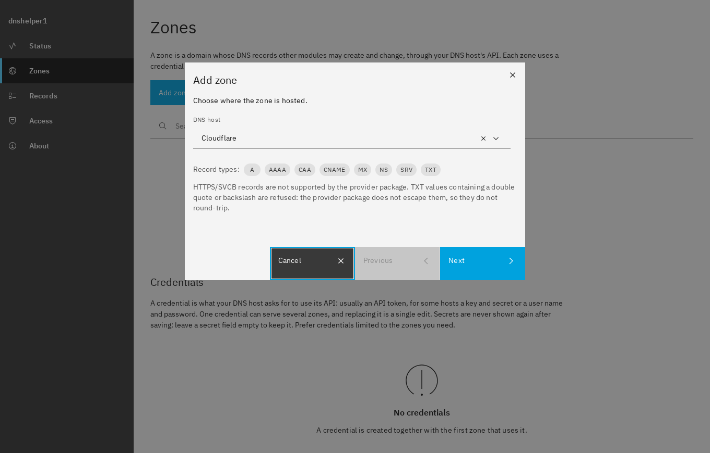

**2. Enter the credential.** Give it a name you will recognise later (for example the DNS host and
the zone), then fill in the fields your DNS host needs. Secret fields are masked (the eye icon
shows what you typed) and can never be read back once saved.

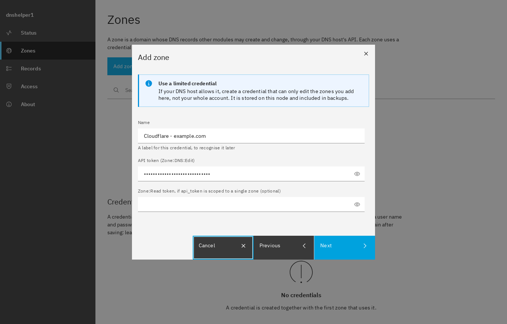

**3. Choose the zone.** If the credential can list its zones, pick one from the list, or type the
name. Some DNS hosts cannot list zones, and then you type it. **Find zones used by my modules**
shows the domains that your mail, web server and other modules already use, so you can pick one.
They are suggestions only: a domain your mail server uses is not necessarily hosted at this DNS
host.

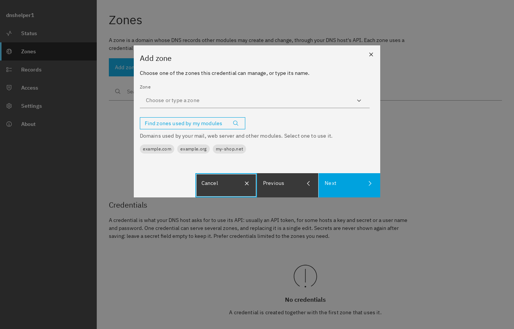

**4. Review.** dnshelper checks that the credential works for the zone and shows what it can do
there (read, add, replace and delete records). It does not change anything while checking. Choose
**Test write access** if you also want proof that changes are allowed: dnshelper then adds a
temporary TXT record named `_dnshelper-test-...` and deletes it again. Nothing else is touched.

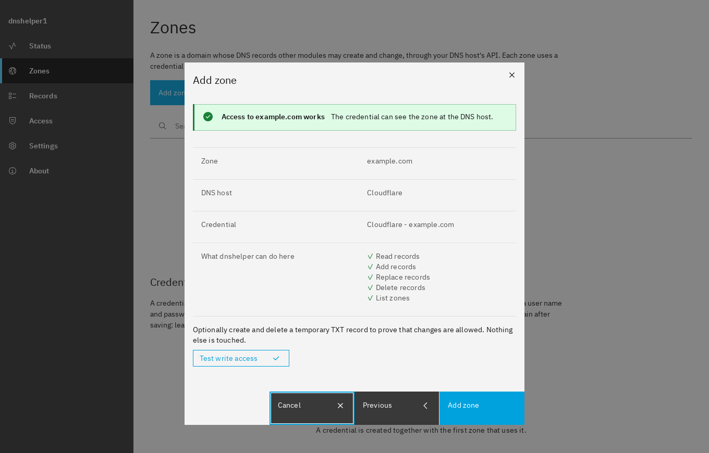

If the check fails, the message says why (see [When something goes wrong](#when-something-goes-wrong)).
Choose **Previous** to correct the credential or the zone.

## Managing zones and credentials

The **Zones** page has two tables.

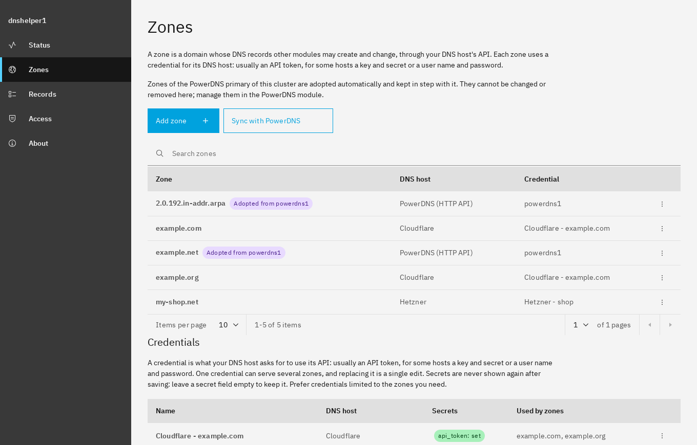

**Zones.** Zones adopted from the PowerDNS module carry an **Adopted from powerdns1** tag (see
[Zones from the PowerDNS module](#zones-from-the-powerdns-module)). The three dots at the end of a
row open a menu:

- **Check credentials** tests again that the credential works for the zone. Use it after you
  changed something at your DNS host.
- **Change credential** makes the zone use another saved credential from now on. The records are
  not touched.
- **Delete** stops managing the zone. dnshelper asks you to type the zone name to confirm. The
  records at your DNS host are **not** deleted, and the credential is kept. Modules can no longer
  change the zone's records.

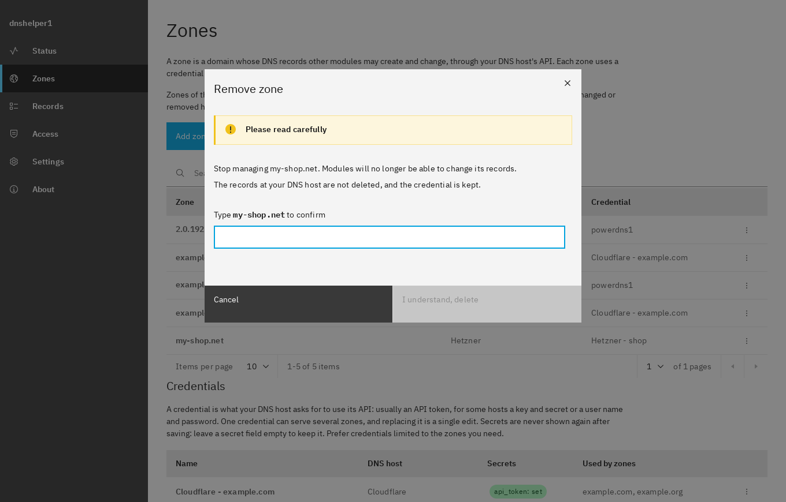

**Credentials.** One credential can serve several zones. The table shows which zones use each one.

- **Edit** changes the name or the values. Secret fields are empty when you open the dialog:
  leave a secret empty to keep the stored value, or type a new one to replace it. **This is how
  you rotate a token**: create a new one at your DNS host, edit the credential here, and then
  revoke the old token.
- **Delete** removes a credential that no zone uses. The token stays valid at your DNS host: revoke
  it there too if it should stop working.

### Zones from the PowerDNS module

If the cluster runs the PowerDNS module (ns8-powerdns) as a primary DNS server, dnshelper adopts its
zones by itself: there is no credential to enter, and the PowerDNS API key is never shown. The zones
appear in the table with an **Adopted from powerdns1** tag (the name of the PowerDNS module), and
their credential appears in the credentials table under that name, with the same tag.

They follow the PowerDNS module. A zone added there shows up here within seconds, and a zone
removed there disappears here. If the PowerDNS module is removed, its zones and their credential
are removed here too; the records stay on the server. **Sync with PowerDNS** does the same at
once, and says what it adopted or removed. Use it if a zone has not shown up, for example after
the PowerDNS module was restarted.

Adopted zones cannot be edited, given another credential or deleted here: their menu only offers
**Check credentials**. Manage them in the PowerDNS module. A zone you had already added here by hand
is left as it is; to have it adopted instead, delete it here and choose **Sync with PowerDNS**.

The records of an adopted zone are changed on the Records page like those of any other zone,
including the PTR records of a reverse zone (`2.0.192.in-addr.arpa`). The PowerDNS module's own
Records page shows them read-only while dnshelper manages the zone, and links to this page.

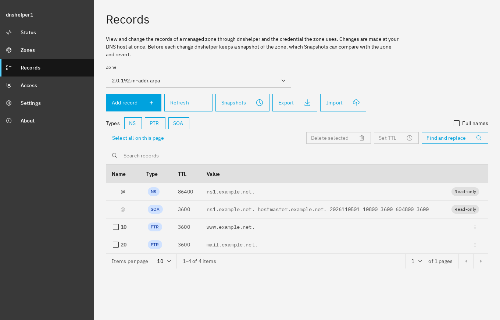

Other modules need access rules for adopted zones like for any zone: adopting a zone does not let
any module change it.

## Letting modules change DNS records

Modules are **denied everything until you allow them**. A module that is installed and allowed to
*call* dnshelper still cannot read or change a single record until there is a rule for it. That is
deliberate: a module that misbehaves, or a bug, can only touch what you granted.

If a module is refused, its own error will say something like "not permitted", and dnshelper's
audit log shows the refusal. That means a rule is missing.

Open **Access**. The table lists the rules.

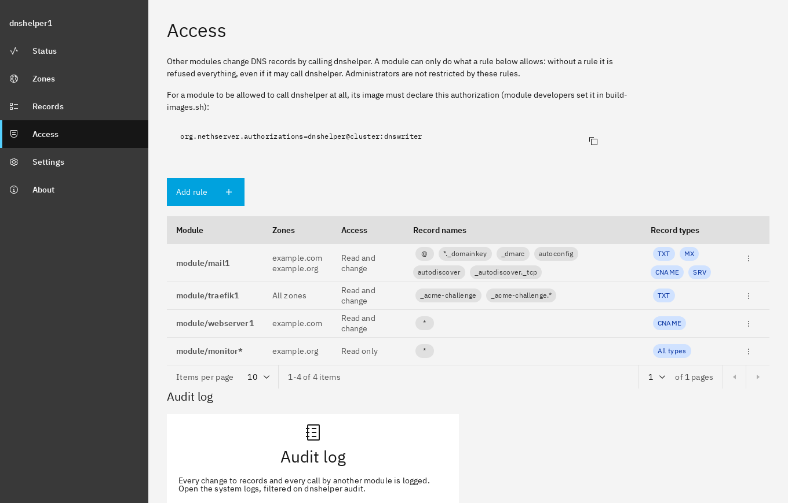

Each rule has:

| Field | Meaning |
|---|---|
| **Module** | `module/` followed by the module's name, such as `module/mail1`. A pattern works too: `module/mail*` covers every module whose name starts with `mail` |
| **Zones** | The zones the rule covers: tick one or several, or **All zones** |
| **Access** | *Read only* lets the module look at records. *Read and change* also lets it add and delete them |
| **Record names** | Which names the module may touch, relative to the zone. `@` is the zone itself, `www` is `www.example.com`. `*` matches any text (dots included) and `?` matches one character, so `*._domainkey` matches `mail._domainkey`. A single `*` means every name |
| **Record types** | Which types, such as `TXT, MX`. A single `*` means every type. A module can only delete without naming a type if the rule says `*` |

A module's request is checked as a whole: if any record in it is not covered, nothing is changed.
Reading follows the same rules: a module only sees the records a rule covers, and only the zones
it has a rule for.

Choose **Add rule**. Four buttons at the top fill in typical values so you do not have to type
them; you still choose the module and the zones.

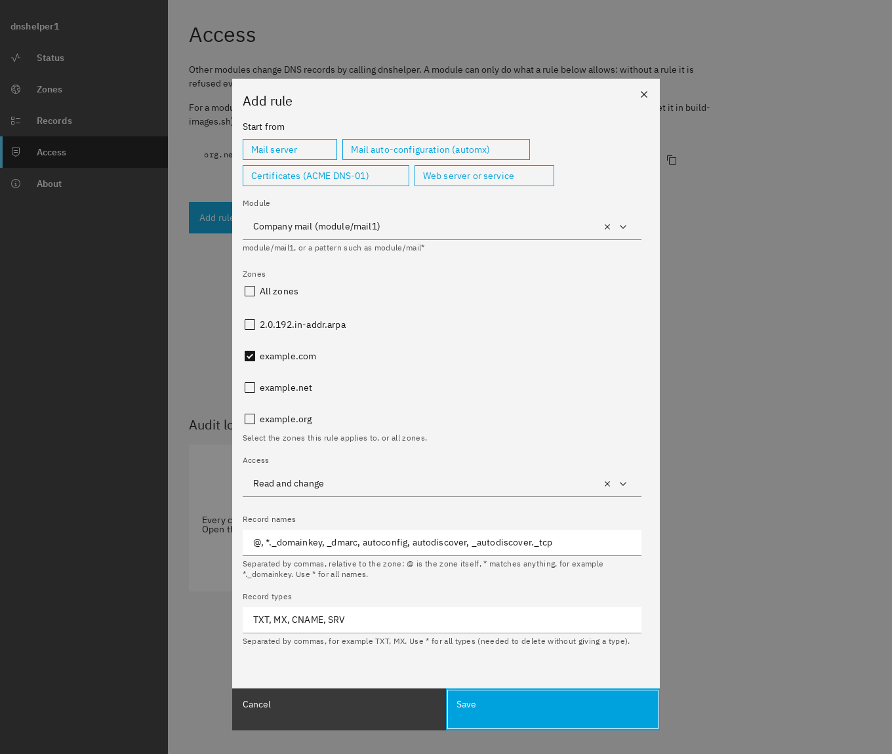

| Preset | Record names | Record types | For |
|---|---|---|---|
| **Mail server** | `@`, `*._domainkey`, `_dmarc`, `autoconfig`, `autodiscover`, `_autodiscover._tcp` | TXT, MX, CNAME, SRV | A mail server publishing its SPF, DKIM and DMARC records, MX and mail auto-configuration |
| **Mail auto-configuration (automx)** | `autoconfig`, `autoconfig.*`, `autodiscover`, `autodiscover.*`, `_autodiscover._tcp`, `_autodiscover._tcp.*` | CNAME, SRV | [ns8-automx](https://github.com/danb35/ns8-automx), publishing the records mail clients use to find their settings, for mail domains at a zone's apex or below it |
| **Certificates (ACME DNS-01)** | `_acme-challenge`, `_acme-challenge.*` | TXT | A module that proves domain ownership to get a certificate, for example a wildcard certificate |
| **Web server or service** | `*` | CNAME | A web server, or an application on its own host name (SOGo, Grafana, Matomo...), that points a name at your server |

Some habits that keep this safe:

- **Grant the least that works.** Name the zones instead of *All zones* when a module only needs
  one, and leave the presets' names and types as they are unless you know why you need more.
- **Prefer *Read only*** for anything that only needs to look, such as a monitoring module.
- The three dots at the end of a row let you **edit** or **delete** a rule. Deleting takes effect
  at once.
- A rule can be added before the module is installed, and stays until you delete it. After a
  restore, a rule for a module that no longer exists is kept.

The **Access** page also shows the line that a module's developers add to their image so that the
module may call dnshelper at all (`org.nethserver.authorizations=dnshelper@cluster:dnswriter`).
You do not need to do anything with it: it is there for people who write modules.

## Working with records

**Records** lets you see and change the records of your zones yourself, through dnshelper and the
credential each zone uses. It works the same for every DNS host. Changes are made at your DNS host
at once, and they are real: deleting the record of a running service takes the service down.

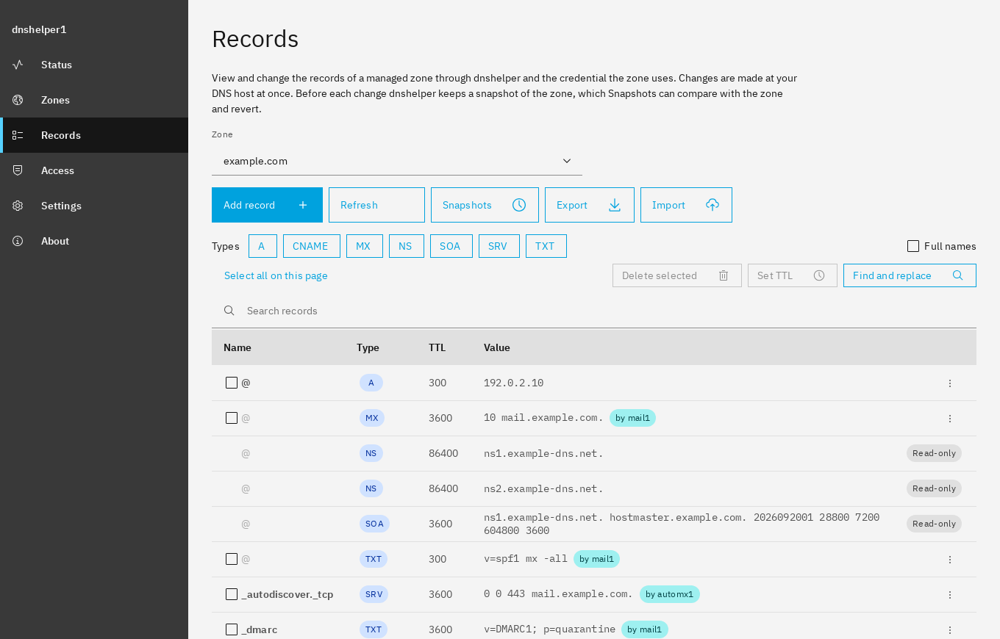

- [Finding records](#finding-records)
- [Adding, editing and deleting a record](#adding-editing-and-deleting-a-record)
- [Records written by modules](#records-written-by-modules)
- [Collecting changes and applying them together](#collecting-changes-and-applying-them-together)
- [Changing many records at once](#changing-many-records-at-once)
- [Exporting and importing a zone file](#exporting-and-importing-a-zone-file)
- [Snapshots: undoing changes](#snapshots-undoing-changes)
- [PTR records](#ptr-records)
- [Checking that a change has reached the name servers](#checking-that-a-change-has-reached-the-name-servers)

### Finding records

Pick a zone, and the table lists its records: the zone itself (`@`) first, then by name and type.
When a name repeats the row above it is shown in grey, so the records of one name read as a group.
You can search and sort, and **Refresh** reads the zone again. Long values, such as a DKIM key,
are shortened; hover over one to see all of it.

The buttons next to **Types** show only the record types you pick (pick several, or **All types**
to see everything again). **Full names** shows `www.example.com` instead of `www`. Names in other
scripts (`xn--...`) are shown as you would write them, such as `bücher.example`; hover over one to
see how it is stored.

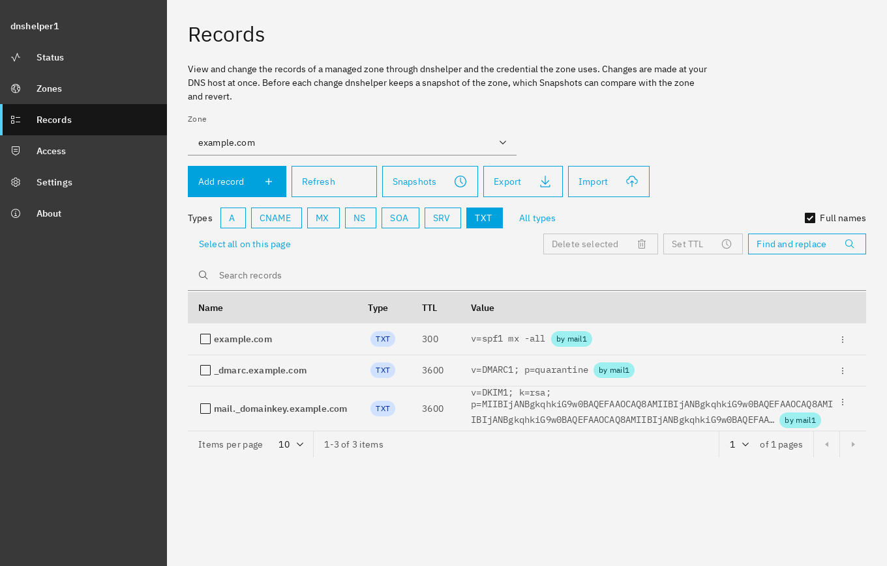

The zone's own NS and SOA records are marked **Read-only**: they belong to your DNS host, and
dnshelper never changes them.

### Adding, editing and deleting a record

**Add record** asks for a name (`www`, or `@` for the zone itself), a type and the value, and an
optional TTL. The type list only offers what your DNS host can handle. The value has a form of its
own for the common types:

- **A** and **AAAA**: the address, checked as you type.
- **CNAME**, **NS** and **PTR**: a host name, such as `host.example.net`. dnshelper adds the final
  dot. An NS record at `@` is refused (the zone's own name servers belong to your DNS host); an NS
  record at another name delegates that name to other name servers.
- **MX**: the preference (lower is tried first) and the mail server. A single `.` as the mail
  server means the domain receives no mail.
- **SRV**: priority, weight, port and target. The name says which service it is, such as
  `_autodiscover._tcp`.
- **CAA**: flags (usually 0), tag (`issue`, `issuewild` or `iodef`) and value, such as
  `letsencrypt.org`.
- **TXT**: the text, without quotes. It shows how many bytes it takes; a value longer than 255
  bytes is split for you. Line breaks are removed, so you can paste a DKIM key as your mail server
  gives it. The form recognises SPF, DKIM and DMARC records, and warns when a name would get a
  second SPF record, which makes SPF checks fail.

Leave the TTL empty to use your DNS host's default. Some hosts have a minimum TTL and raise a
shorter one (see [When something goes wrong](#when-something-goes-wrong)).

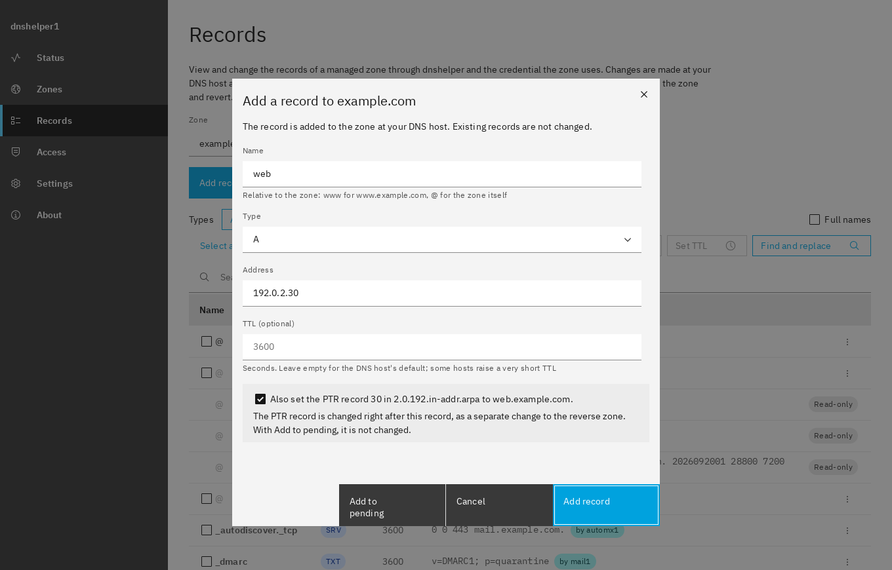

The three dots at the end of a row open a menu with **Edit**, **Check propagation** and
**Delete**. **Edit** opens the same form with the record's values. Saving replaces the record in
one step, so you can also change its type, for example turn an A record into a CNAME. If the
record was changed at your DNS host since the page was loaded (by another module, or in your DNS
host's own control panel), nothing is changed and dnshelper tells you so: choose **Reload the
records** and try again.

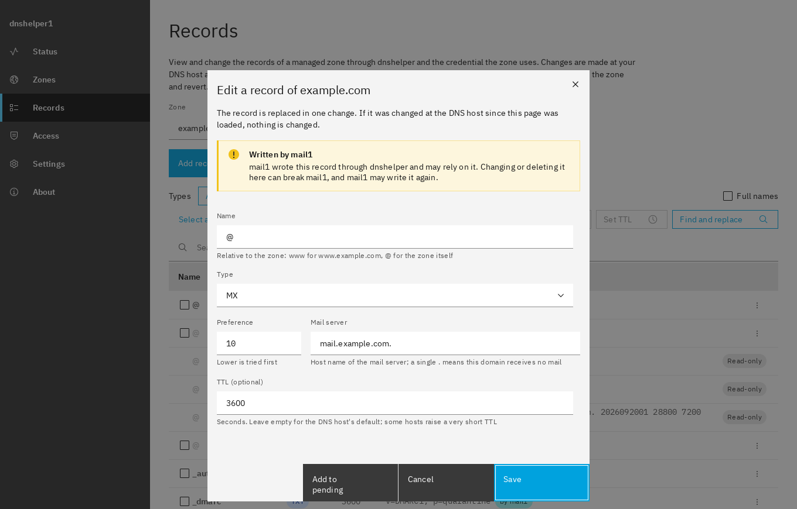

**Delete** removes the record, after a confirmation. Other records with the same name stay.

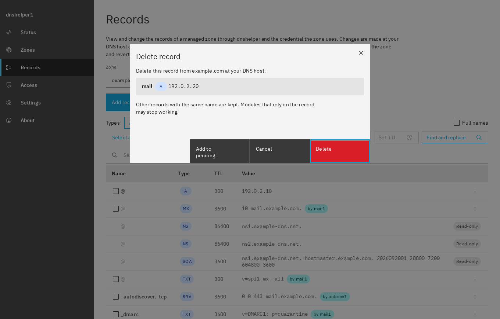

### Records written by modules

A record that a module wrote through dnshelper carries a tag with the module's name, such as
**by mail1**. Editing or deleting it shows a warning: the module may rely on the record, and may
write it again. Records written before dnshelper kept track of this (version 0.6.0) carry no tag.

When a module is removed from the cluster, the records only it wrote are not deleted. They are
marked **from removed automx1**, and the page lists them: **Add deleting them to pending changes**
puts their deletion in the pending changes (below), to review and apply, and **Keep them** keeps
them as ordinary records. A record that another installed module also wrote stays that module's:
when you move a module to another node, the copy takes over its records.

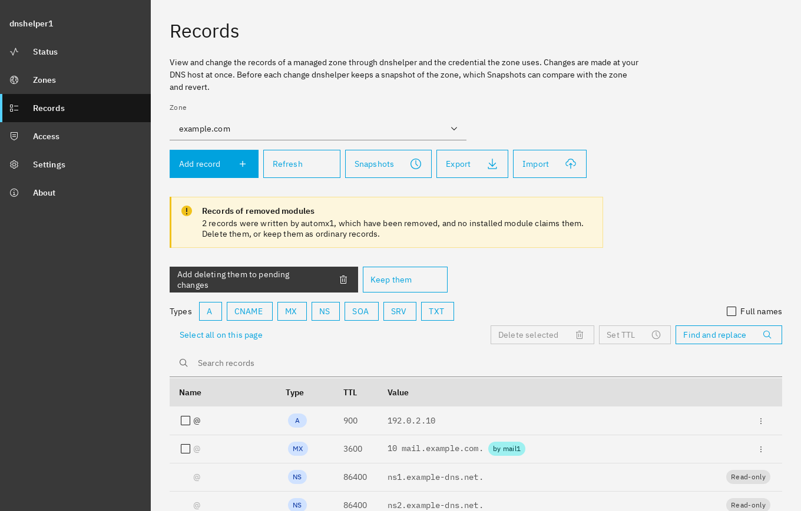

### Collecting changes and applying them together

**Add record**, **Edit** and **Delete** apply at once when you choose **Add record**, **Save** or
**Delete**. Each dialog also has **Add to pending**, which collects the change instead. The pending
changes are listed above the table, each with **Undo**; the rows they touch are tagged and cannot
be changed again until then. While changes are pending, the zone cannot be switched.

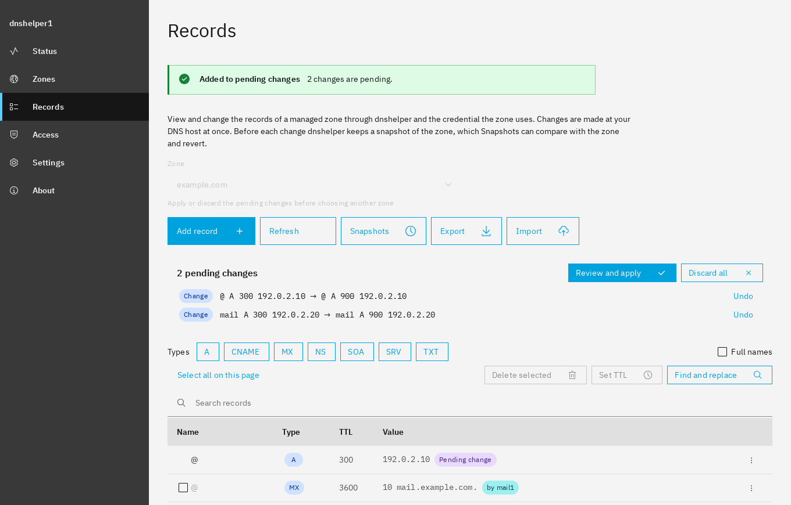

**Review and apply** first asks dnshelper what would actually happen, without changing anything:
a change that turns out to change nothing is left out, and a change that would break the zone
(such as a CNAME next to other records) or a record that was changed at your DNS host meanwhile is
reported before anything is written. **Apply** then makes all the changes in one step. **Discard
all** forgets them.

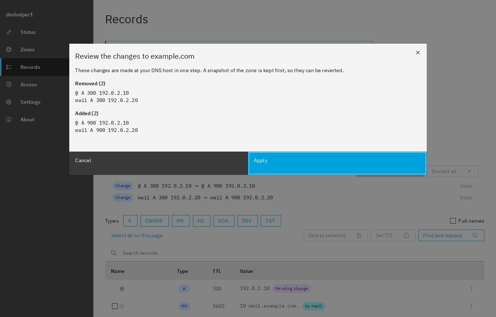

Very many changes (more than 100 records to remove or to add) are applied in parts, one after the
other; the review says so. If one part fails, the parts before it stay applied.

### Changing many records at once

Tick the records you want, or **Select all on this page**, and then:

- **Delete selected** adds their deletion to the pending changes.
- **Set TTL** gives them all one TTL, for example a short one before you move a service.
- **Find and replace** changes text in record values, such as pointing every record at a new host
  or changing an address. It works on the ticked records, or on the whole zone, and can be limited
  to one type and to names matching a pattern (`*` for any characters, `?` for one). It shows what
  would change before anything is added to the pending changes.

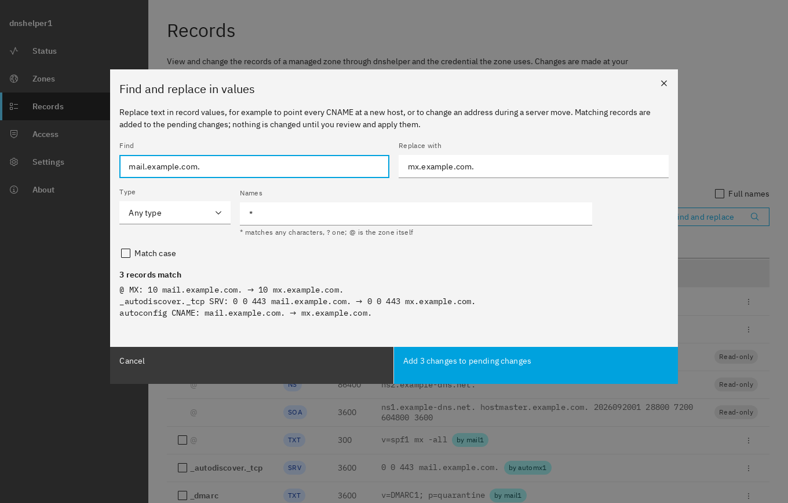

All three go through the pending changes: nothing is changed until you review and apply.

### Exporting and importing a zone file

**Export** downloads the zone as a zone file in BIND format (`example.com.zone`). It is a record
of the zone, and the way to move a zone to another DNS host.

**Import** reads a zone file: paste it, or choose a file. Choose whether to **add** only the
records the zone does not have, or to **make the zone match the file**, which also removes the
records the file does not have, including records other modules wrote. **Preview** shows what
would change and what is left out: the SOA record, the zone's own NS records, and names outside
the zone. **Add ... to pending changes** collects the changes; nothing is changed until you review
and apply. `$INCLUDE` lines are not allowed.

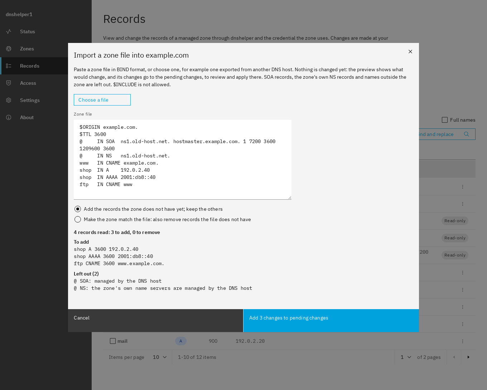

### Snapshots: undoing changes

Before every change made through dnshelper (from this page or by another module), dnshelper keeps
a **snapshot** of the zone as it was. **Snapshots** lists them, newest first, each with what was
changed after it, by whom, and whether it worked. **Take snapshot** keeps one now, with a label
such as "before the server move". **Download** gives you a snapshot as a zone file.

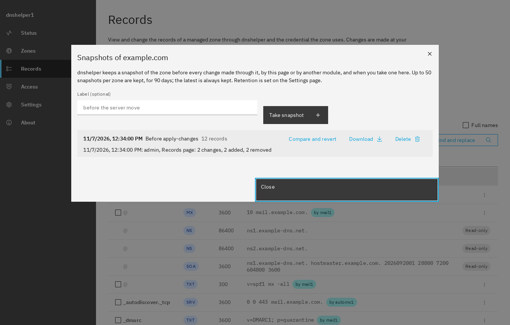

**Compare and revert** lists what would have to change to make the zone as it was in that
snapshot. Untick anything you want to keep as it is now, then apply. Records written by another
module since the snapshot are marked: reverting them may break that module until it writes them
again. Reverting is itself a change, so you can undo it the same way.

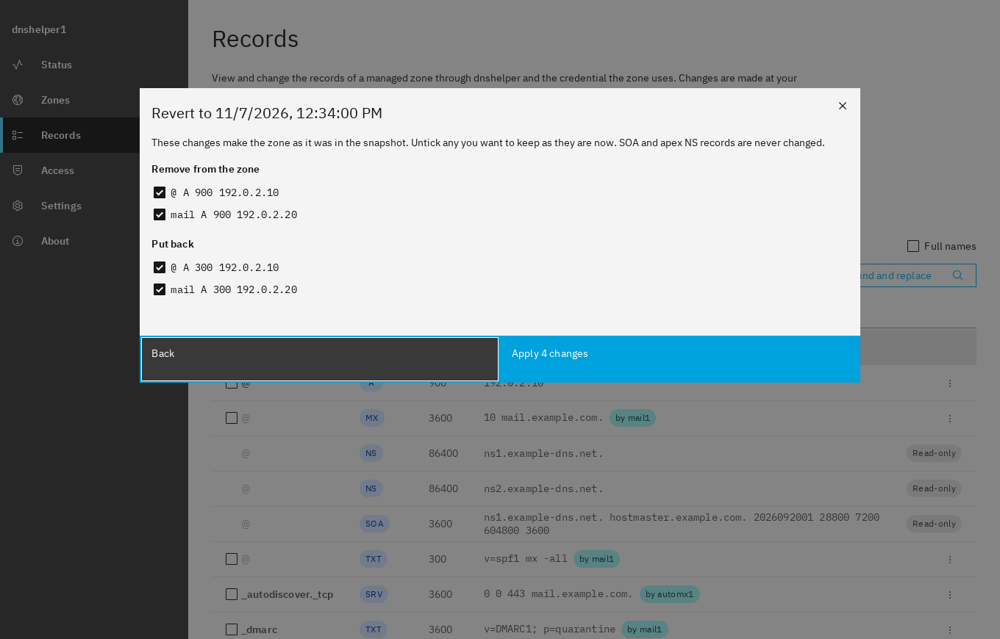

How many snapshots are kept, and for how long, is set on the [Settings](#settings) page. Deleting
a zone on the **Zones** page deletes its snapshots too.

### PTR records

If dnshelper also manages the reverse zone of an address (for example `2.0.192.in-addr.arpa` for
`192.0.2.30`, typically a zone adopted from the PowerDNS module), adding or editing an A or AAAA
record offers to set its PTR record too, and shows what the PTR points to now. Changing the
address offers to remove the old address's PTR; deleting the record offers to delete its PTR.
This is done right after the record is saved, as a separate change to the reverse zone, and not
with **Add to pending**. Today only the PowerDNS host stores PTR records through dnshelper.

### Checking that a change has reached the name servers

**Check propagation**, in a record's menu, asks each of the zone's name servers directly what it
serves for that name and type, and compares it with your DNS host: **Up to date**, **Different**
(not there yet), or **No answer**. **Check again** repeats it. A change usually reaches all name
servers within seconds to minutes. Resolvers that cached the old answer keep it until its TTL runs
out, so a short TTL before a planned change makes it take effect sooner.

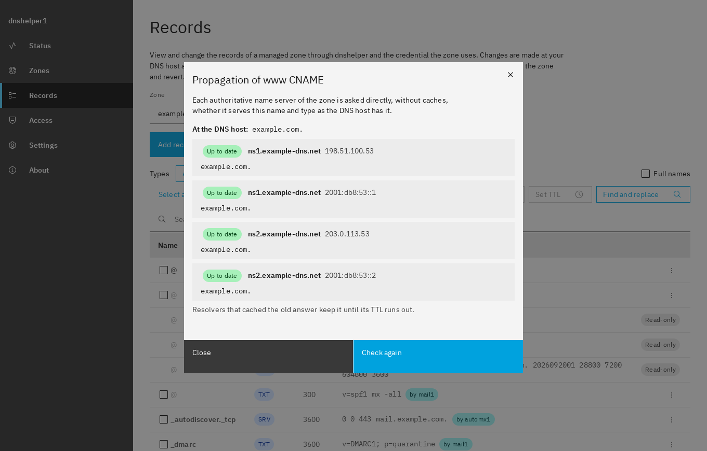

## Settings

**Settings** holds how many snapshots dnshelper keeps for each zone, and for how long. Older
snapshots are deleted when there are more than that, or when they are older; the latest snapshot
of a zone is always kept. The defaults are 50 snapshots and 90 days.

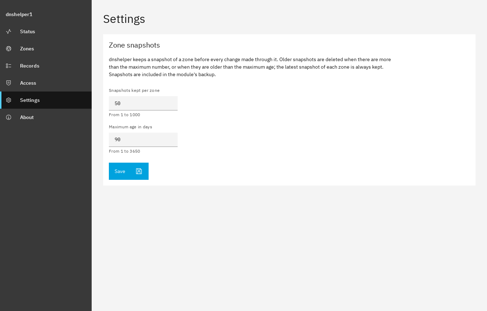

## Seeing what happened: the audit log

Every change dnshelper makes, and every request from another module, writes one line to the
system log, including the ones that were refused. On **Status**, the **Audit log** card opens the
system logs already filtered on `dnshelper audit`; choose **Search** there. A line looks like:

```
dnshelper audit: caller="module/mail1" action="append-records" result="ok"
    zone="example.com" add=["mail._domainkey TXT v=DKIM1..."] remove=[]
```

`caller` is the module (or your administrator name for changes from the Records page), `result` is
`ok` or `rejected`, and a rejection carries the reason. Credentials never appear in the log. The
[snapshots](#snapshots-undoing-changes) of a zone show the same changes on the Records page.

## Backup and restore

dnshelper's backup includes its zones, its access rules **and its credentials**, because a restore
would otherwise leave you with zones that cannot be changed. It also includes the zones'
snapshots, the settings, and which module wrote which record. After a restore, everything is back
and the credentials still work.

Because the credentials are in the backup, treat your backup destination as sensitive. NS8
encrypts backups, but a narrow, revocable token (see [Before you start](#before-you-start)) is
still your best protection.

## When something goes wrong

These are the messages you may see, with what to check.

| Message | What it means and what to do |
|---|---|
| The DNS host rejected the credential, or it has no access to this zone | The token is wrong, expired or revoked, or it is limited to other zones or lacks the DNS permission. Check it at your DNS host, and check that a Hetzner token comes from the project that holds the zone, or that a name.com token is a production token |
| Zone not found at the DNS host, or not managed here | The zone name is misspelled, or the zone is not in the account this credential belongs to. For a module's request: the zone was never added on the **Zones** page |
| Not allowed by the access rules | A module tried something no rule covers. Open **Access** and check the module, the zone, the record names and types, and whether the rule is *Read only* |
| That would leave the zone invalid | The change would break DNS rules, most often a CNAME next to other records with the same name, or a CNAME at the zone itself. Remove the conflicting record first |
| That record cannot be changed | dnshelper never changes a zone's NS and SOA records. Some DNS hosts also cannot store certain characters: Cloudflare, ClouDNS, name.com, RFC 2136 and Vultr do not accept a TXT value that contains a double quote or a backslash, DigitalOcean and Porkbun one that contains a backslash, and Hetzner one that starts or ends with a double quote. DigitalOcean also refuses an underscore in the name of an A or AAAA record, and Linode an SRV record below a subdomain (it only stores `_service._protocol` directly under the zone) |
| This DNS host does not support that | The DNS host cannot do it: for example a record type it does not handle. The review step of the wizard lists what it can do |
| The zone was changed since it was read; compare again | A record you edited, deleted or reverted is no longer the same at your DNS host: a module or someone else changed it after the page was loaded. Nothing was changed. Choose **Reload the records** (or **Refresh**) and do it again |
| The PTR record was not changed | The record was saved, but changing its PTR record in the reverse zone failed; the message says why. Change the PTR record on its own in the reverse zone |
| The credential is still used by a zone | Change the zone's credential, or delete the zone, before deleting the credential |
| This zone (or credential) is adopted from PowerDNS and cannot be changed here | It belongs to the PowerDNS module. Change or remove it there; dnshelper follows within seconds |
| More than one PowerDNS primary | More than one PowerDNS module claims to be the primary. dnshelper changes nothing until only one is left: remove the extra one |
| The PowerDNS primary did not answer, or the cluster leader cannot be reached | Nothing was changed. The PowerDNS module may be starting or updating: wait a minute and choose **Sync with PowerDNS** again |

A few more things that look like problems and are not:

- **A record has a different TTL from the one requested.** GoDaddy raises a TTL below 600 seconds
  to 600, name.com below 300 to 300, Core-Networks below 60 to 60, DigitalOcean below 30 to 30, Porkbun below 60 to 60, Gandi below 300 to 300, Vultr, IONOS and OVHcloud below 60 to 60, and deSEC below the domain's own minimum to that minimum. Linode rounds any TTL up to the next value it allows (30, 120, 300, 3600, ...), and ClouDNS too (60, 300, 900, 1800, 3600, ...).
- **Hetzner and Vultr are slow.** Each action takes several seconds there (8 to 15 at Hetzner); that is the DNS host, not a fault.
- **GoDaddy limits the number of requests** to about 60 a minute. dnshelper waits and tries again.
- **deSEC limits changes** to 15 a minute and 100 an hour per domain. dnshelper waits up to 90 seconds;
  beyond that it says how long to wait before trying again.
- **Core-Networks limits how often you can log in.** dnshelper logs in once and reuses the session for
  up to an hour. If you see that logins are limited, wait a few minutes and try again.
- **Check propagation says "No answer" for some addresses.** The name server did not answer from
  your NethServer. "No answer over IPv6" usually means that your NethServer has no working IPv6
  connection, not that the name server is down.
- **A record's "by" tag disappeared.** You edited it, or deleted and added it again: it is then
  your record, not the module's.
- **The zone list is empty or the wizard asks you to type the zone.** Some credentials are not
  allowed to list zones, and some DNS hosts cannot. Type the zone name.

If something still does not work, the audit log and the system log of the dnshelper module (Logs
in the NS8 admin interface, module `dnshelper`) show what was asked and what was answered.
Please report bugs at <https://github.com/danb35/ns8-dnshelper/issues>; do not include tokens or
passwords.
